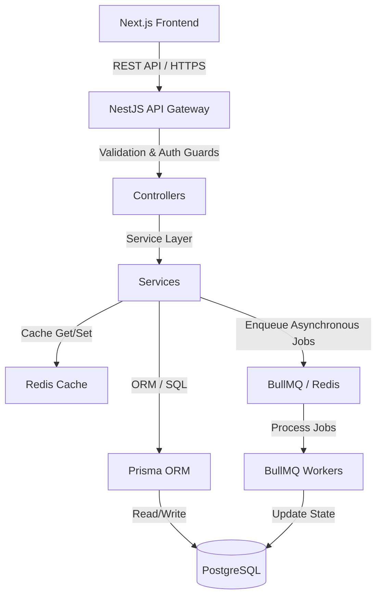

# Nexaris Architecture Guide

This document describes the high-level architecture, design patterns, and operational systems of the Nexaris marketplace platform. It is designed for engineers onboarding to the project or looking to understand the system topologies.

---

## High-Level Architecture

Nexaris uses a modular monolith architecture built on **NestJS** and **Next.js**. The backend is structured into domain-specific modules, communicating in-process via Event Emitters or out-of-process via **BullMQ** queues.



---

## Core Infrastructure

### 1. Database Layer (PostgreSQL & Prisma)
Nexaris uses PostgreSQL for persistent data. Prisma ORM is utilized for database operations, schema migrations, and relational integrity.
*   **Prisma Client**: Injected globally via `PrismaModule`.
*   **Query Profiling**: Slow query logger catches queries taking $>150\text{ms}$ and prints warn logs.
*   **Database Migrations**: Defined under `backend/prisma/migrations/`.

### 2. Caching & State Layer (Redis)
Redis serves two primary functions:
*   **Application Cache**: High-traffic reads (personalized recommendation feeds, category trees, and search autocomplete structures) are cached with logical time-to-live (TTL) limits.
*   **Queue Store**: Stores serialized BullMQ jobs, retry states, and dead-letter queues.

### 3. Background Job Queue (BullMQ)
For slow or heavy computational tasks, jobs are sent to Redis-backed queues. This keeps client HTTP responses fast ($<100\text{ms}$).
*   **Fulfillment Queue**: Processes invoices and transactional updates.
*   **Shipping Update Queue**: Polls tracking numbers and simulates carrier updates.
*   **Notification Queue**: Asynchronously dispatches push alerts and emails.
*   **Recommendation Queue**: Recalculates pairwise product similarity scores and preference weights.

---

## Key Design Patterns

### Abstraction Layer (Provider Pattern)
For external services like logistics providers (Shiprocket, Delhivery, BlueDart) or payment gateways (Razorpay, Stripe), Nexaris uses an Adapter pattern:
1.  An abstract base class or interface defines the contract (e.g. `ShippingProvider`).
2.  Concrete adapter classes implement the contract (e.g. `ShiprocketAdapter`).
3.  A registry or factory instantiates and fetches the active adapter based on database parameters or environment configurations.

This permits changing providers without rewriting business modules.

### Resilient Fallback Cache
If Redis becomes unavailable, the system automatically falls back to an in-memory `Map`-based cache inside the application process (`RedisService`). Once Redis restores, the client automatically reconnects and updates the cache state.

---

## Directory Layout

```
backend/
├── prisma/                 # Database Schema, Seed scripts, and migrations
├── src/
│   ├── auth/               # Passport JWT Authentication & guards
│   ├── products/           # Catalog management
│   ├── orders/             # Order state, line items
│   ├── payments/           # Mock & Razorpay payment integration
│   ├── shipping/           # Carrier adapters (Shiprocket, Delhivery, BlueDart)
│   ├── recommendations/    # Similarity & preference engines
│   ├── search/             # FTS, fuzzy fallback trigrams, synonym expansions
│   ├── redis/              # Resilient cache service
│   ├── queue/              # BullMQ module, workers, and DLQs
│   ├── metrics/            # Prometheus API metrics exporter
│   └── app.module.ts       # Application container definition
```
